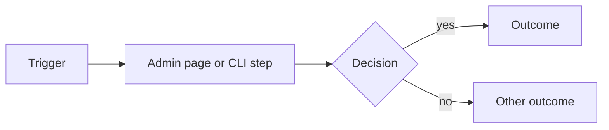

# Design proposal template

> **Status:** template · **Last reviewed:** 2026-10-23
>
> A design proposal is a **design artifact** that needs a review record: a mockup, a data
> flow, interaction notes. It is not the work queue. Authorization comes from a proposal
> in `docs/proposals/` (see `docs/PROPOSAL_CREATION_SOP.md`), and this document names the
> proposal it supports.
>
> This is Job Hunter's local variant of the hub template
> (`hybrid-creator-platform/design-system/proposals/TEMPLATE.md`; see
> [`../DESIGN-SYSTEM-POINTER.md`](../DESIGN-SYSTEM-POINTER.md)). It keeps the hub's
> section names. A section that doesn't apply says "Not applicable" and why; it isn't deleted.
>
> Copy to `docs/design/proposals/<YYYY-MM-DD>-<short-name>.md`, delete this block, and
> fill in every section.

# `<Short title>`

| Field | Value |
|---|---|
| Status | Draft, Under review, Accepted, Rejected or Superseded |
| Date | `YYYY-MM-DD` |
| Author | `<role>` |
| Relates to | `<docs/proposals/... file and gap/decision IDs, e.g. JH-0NN, JHD-REDESIGN-D0N>` |
| Hub tokens or components touched | `<list, or "none — local only">` |
| Surface | `<admin/static/index.html page or section, README/USER_GUIDE copy, CLI output>` |
| Release profile | Local single-user (anything hosted is blocked on JH-D01) |

## Problem

What's wrong or missing, with evidence: a screen, a file and line, a contrast ratio. Label
each claim **Verified**, **Inferred**, **Proposed** or **Blocked**. If the problem is "we
want", say so.

## Proposal

One paragraph: what changes, and what stays the same.

## Mockup

At least one of the following, with the viewport, theme and state each one shows. The
admin is dark-only today; say so if no light mock is included.

- **Mermaid** for flows and sequences. It renders on GitHub and diffs as text.
- **SVG** for layout. It's text, so it diffs and reviews.
- **Image** only when neither fits. Keep it small. Never commit a screenshot that contains a
  real profile, resume, email, phone or job history: use the synthetic example profile.

## Data flow

What the design reads, writes and shows, and where each value lives.

| Datum | Source of truth | Shown where | Local or cloud | Notes |
|---|---|---|---|---|
| `<datum>` | `<output/{profile}/jobs.csv, form_config.json, profile .py, ...>` | `<page>` | Local | `<privacy, staleness, behavior when missing>` |

Show **observed** state, never optimistic state. Profiles, resumes, form answers and
history stay local. Name any field that would leave the machine, and link the
field-level integration that permits it.

## Interaction notes

Cover each item, or say "not applicable":

- States: default, hover, focus, active, disabled, loading, empty, error, success.
- Keyboard: tab order, keys per control, where focus starts and returns.
- Narrow widths; dark (and light, if one exists).
- **Supervision:** any change near Apply, Submit or dry-run must keep "nothing submits
  without a fresh explicit confirmation." Say how the design preserves it.
- Copy: the register (OpenTechnology family: deep, warm, measured, narrative; registers,
  not names) and the exact strings that matter.

## Accessibility

The contrast pairings the design introduces (computed ratios), the WCAG success criteria
it touches, and labels for assistive technology. Write down what was checked by hand. Don't
just write "accessible".

## Token and component impact

| Item | New, changed or deprecated | Hub change or local override | Why |
|---|---|---|---|
| `<css variable or rule>` | `<new / changed / deprecated>` | `<local override — record in the pointer §3>` | `<reason>` |

## Open questions

- [ ] `<question for the owner>`

## Decision gates

| Gate | Decision needed | Decided by | Evidence required | State |
|---|---|---|---|---|
| G1 | `<e.g. accept the visual change>` | Owner | `<mockup reviewed; contrast pairs pass>` | open |

Accepting a design proposal doesn't adopt hub tokens. Adoption follows the hub's approval record.

## Out of scope

What this deliberately leaves open, so a reader doesn't assume it was decided here.

## Next steps

What must happen before this is Accepted, and who does it.
